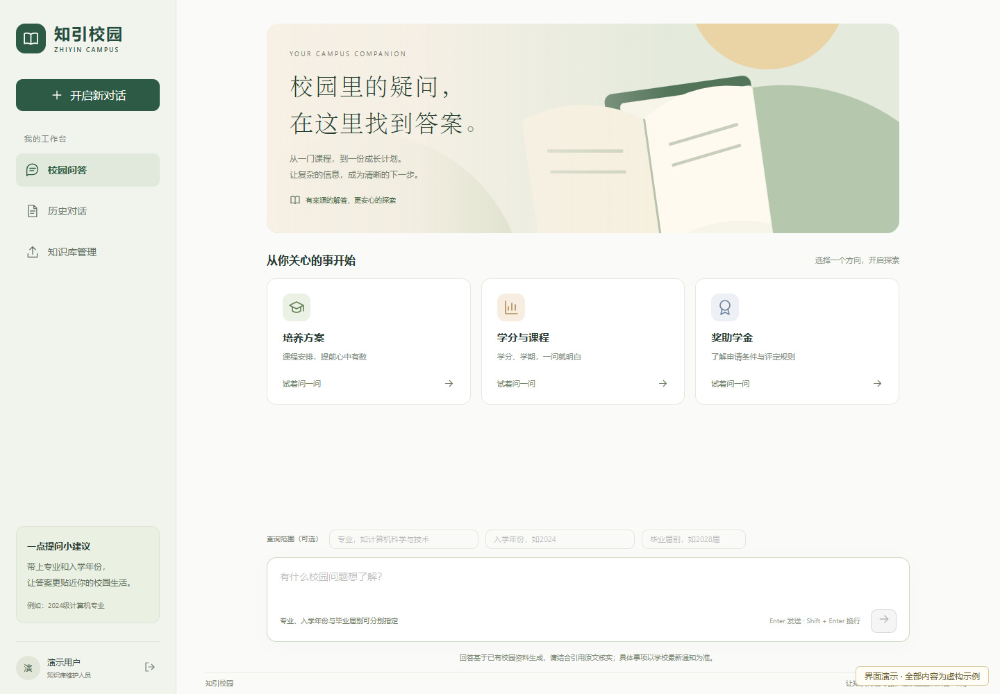
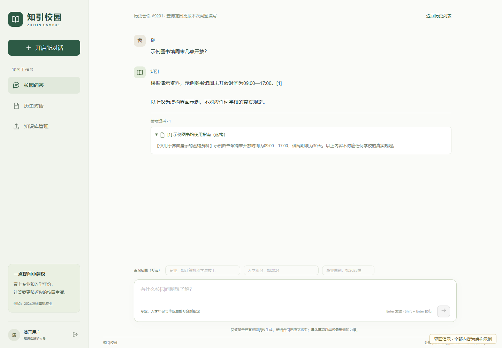
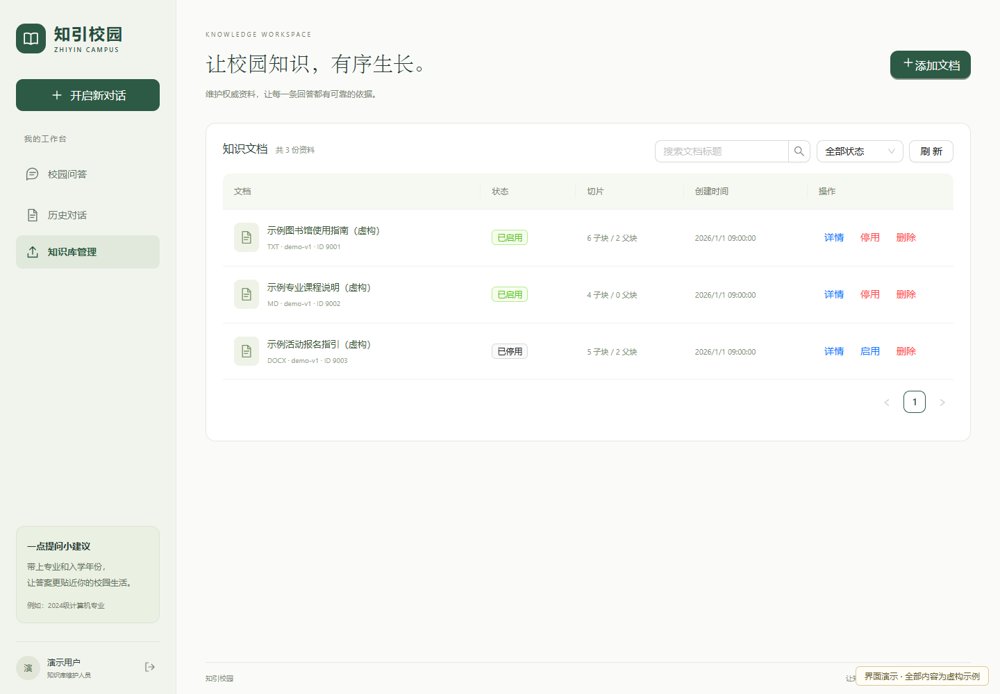
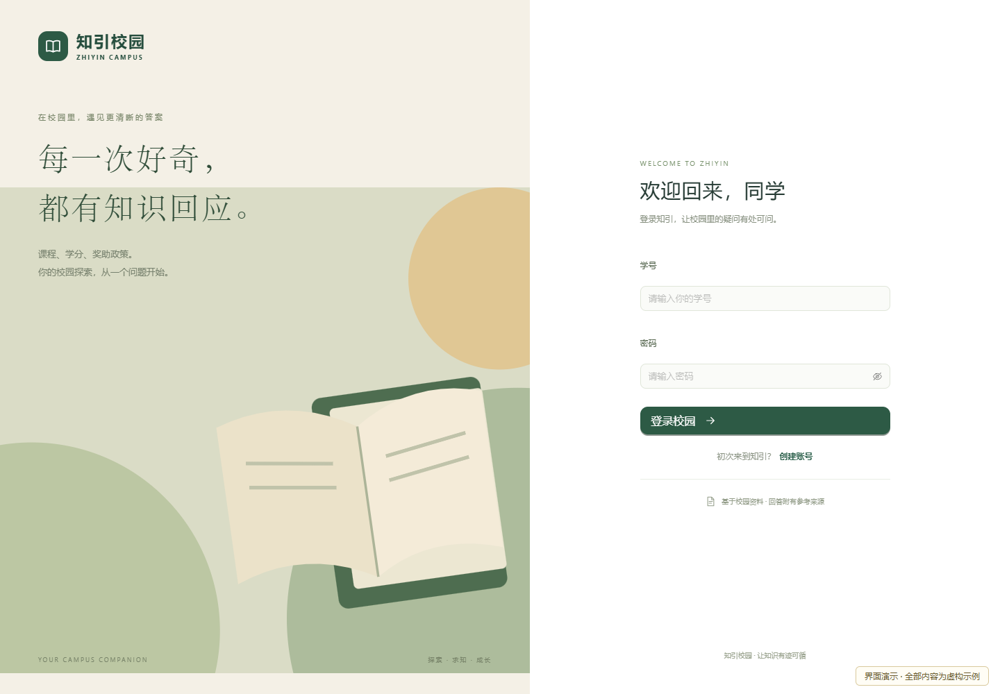
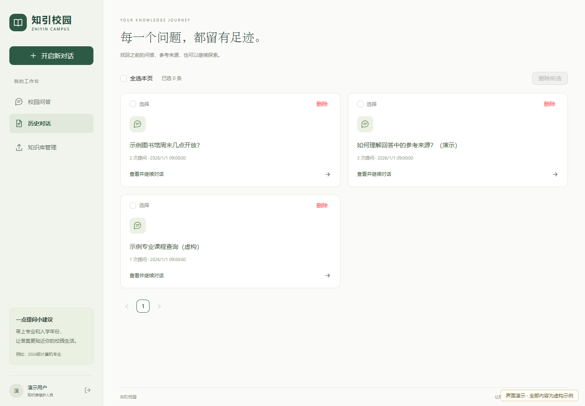
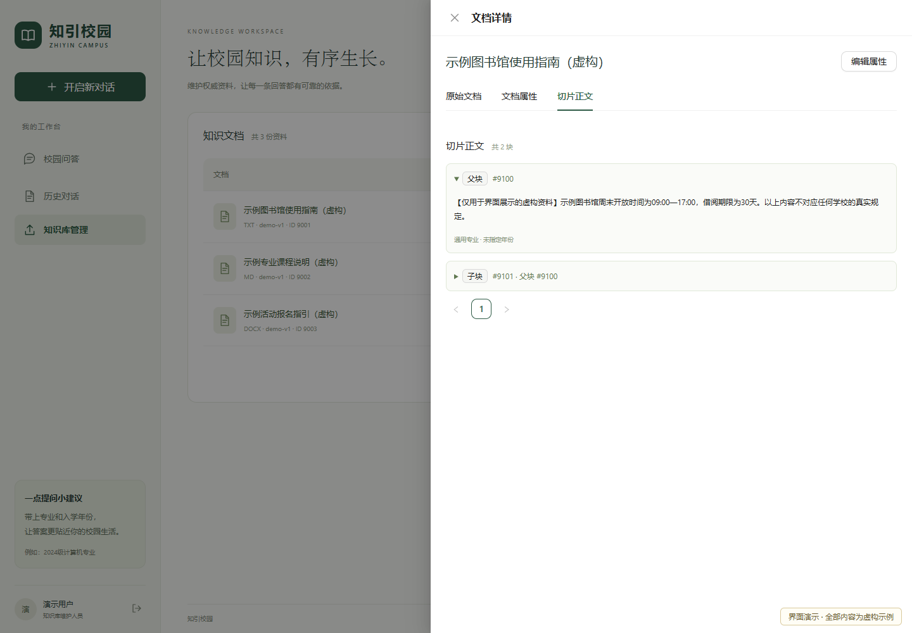
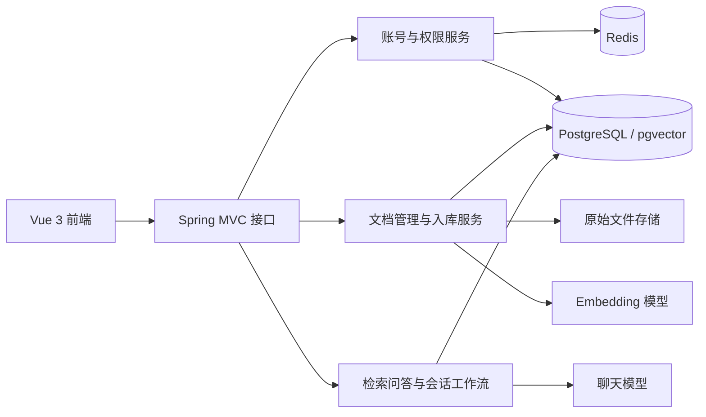

# 知引校园 · Zhiyin Campus

基于 **Vue 3 + Spring Boot** 的校园知识问答与文档检索平台。通过维护知识文档、检索原文证据和生成带引用的回答，帮助使用者查找课程、培养方案与常见事务信息。

> 本页介绍前端与 Java 后端。页面截图全部采用虚构展示数据，装饰图也替换为通用插画；不包含真实学校名称、校徽、文档原文、人员信息或可用凭证。

[项目目的](#项目目的) · [功能设计](#功能设计) · [页面展示](#页面展示) · [技术栈](#技术栈) · [运行环境](#运行环境) · [本地运行](#本地运行)

## 项目目的

校园信息往往分散在不同格式的文档中，同一问题还可能因专业、入学年份和政策版本不同而有不同答案。只做关键词搜索，使用者仍需要逐份阅读；直接让大模型回答，又可能遇到资料过时、版本混用或没有依据的内容。

知引校园希望把“查找资料—确定适用范围—核对原文—理解答案”连接起来：

- **减少查找成本**：通过自然语言提问，统一检索 PDF、Word、表格和文本资料。
- **明确适用范围**：分别处理专业、入学年份、毕业届别与文档版本，降低相似资料串用的风险。
- **让答案可追溯**：展示参考资料与引用正文，方便继续核实原文。
- **支持持续维护**：提供文档上传、预览、属性编辑、启停与版本重建能力。
- **保留业务过程**：保存历史对话、检索与生成轨迹，支持反馈、审计和问题排查。

平台适合作为校园知识服务、RAG 检索问答和前后端分离应用的实践项目。正式使用时，知识资料及其更新仍需由有权限的维护人员管理。

## 功能设计

| 模块 | 当前实现 |
| --- | --- |
| 账号与权限 | 注册、登录、令牌刷新和退出；学生、编辑、管理员等角色；账号启停与实时权限检查 |
| 知识库管理 | 文档搜索与分页、原文件查看/下载、父子切片预览、属性编辑、启停和软删除 |
| 文档处理 | PDF、DOCX、XLSX、MD、HTML、TXT；递归/父子切片；课程表行保留与来源元数据 |
| 检索问答 | 范围路由、查询规划、向量与关键词召回、RRF 融合、规则重排、证据过滤和引用校验 |
| 课程查询 | 根据实际课程记录提供学分、学期及课程清单，完整清单使用全量范围内记录 |
| 会话与记忆 | 历史查看与继续提问；用户画像、会话范围与有界最近对话辅助理解追问 |
| 可靠工作流 | 请求幂等、完成结果重放、冲突保护、取消与租约恢复；持久化异步入库任务与显式重试 |
| 追踪与评测 | 问答来源快照、检索/生成轨迹、反馈、审计及证据评测接口 |

前端目前主要提供登录/注册、校园问答、历史对话和知识库管理页面。部分高级工作流能力由后端接口提供，尚未全部做成独立的前端交互；现有问答页面使用普通 HTTP 问答接口，后端另外提供 SSE 流式接口。

## 页面展示

**展示说明：**截图来自当前前端组件，由浏览器注入固定的虚构账号、文档和问答数据，仅展示交互界面；不读取实际业务库，也不作为真实模型效果或检索质量的证明。所有数字、时间和文档名称均为示例。

### 校园问答首页

提供常用提问入口、问题输入区，以及专业、入学年份和毕业届别等查询范围。



### 回答与参考来源

回答附有来源编号，参考资料可展开查看正文，便于理解答案依据。



### 知识库管理

维护人员可以查看文档状态、切片数量和版本，并进行搜索、上传、启停、属性编辑等操作。



<details>
<summary>查看登录页面</summary>



</details>

<details>
<summary>查看历史对话页面</summary>



</details>

<details>
<summary>查看文档详情与父子切片</summary>



</details>

## 系统结构



Java 后端采用 **Controller → Service → Repository / Mapper** 分层。文档入库与问答是两条相互配合的链路：

```text
文档入库：文件校验 → 正文/课程行解析 → 父子或递归切片 → 子块向量化 → 事务发布

检索问答：身份与请求声明 → 范围/追问解析 → 有效文档路由
          → 精确课程事实 / 混合检索 → 证据过滤 → 回答与引用校验 → 保存结果
```

向量检索使用 pgvector 余弦距离；关键词检索采用 PostgreSQL 全文检索与中文关键词匹配，当前不是严格 BM25。重排是规则加权实现，没有接入 Cross-Encoder 模型。确定性课程回答与模型生成会分别记录，资料不足时返回空来源拒答。

## 技术栈

版本以 [pom.xml](pom.xml)、[frontend/package.json](frontend/package.json) 和锁文件为准。

### 前端

| 技术 | 用途 |
| --- | --- |
| Vue 3.5、TypeScript 6 | 组件开发、Composition API、类型约束 |
| Vite 8 | 开发服务器、接口代理与生产构建 |
| Ant Design Vue 4 | 表单、表格、抽屉、分页及反馈组件 |
| Vue Router 4 | 登录、问答、历史与管理页面路由 |
| Axios | HTTP 请求、Bearer 令牌与刷新处理 |
| ESLint、vue-tsc | 静态检查与类型检查 |
| Playwright | 浏览器交互验证 |

### Java 后端

| 技术 | 用途 |
| --- | --- |
| Java 21、Spring Boot 3.5.5、Spring MVC | REST API、业务服务与应用生命周期 |
| Spring Security、BCrypt、JJWT | 认证、密码校验、JWT 与权限控制 |
| MyBatis / MyBatis-Plus、JDBC | 持久化映射、参数化 SQL 与事务 |
| PostgreSQL、pgvector | 业务数据、全文/关键词检索与 1024 维向量存储 |
| Redis、Lua | 刷新令牌、JWT 撤销与入口限流 |
| LangChain4j 1.14.1、DashScope 集成 | 聊天、Embedding 与真实模型流式输出 |
| Apache PDFBox、Apache Tika | PDF 布局/课程行提取与其他文档正文解析 |
| Spring MVC SseEmitter | SSE 草稿事件与校验后答案输出 |
| Maven | 依赖管理与构建 |

当前 YAML 聊天模型为 `deepseek-v4-flash-0731`，嵌入模型为 `qwen3.7-text-embedding-flash`，向量维度为 `1024`。模型名称、可用区域、权限和额度以实际供应商账号及运行配置为准。

## 运行环境

| 环境 | 要求或用途 |
| --- | --- |
| JDK | **21**，与项目编译目标一致 |
| Maven | 3.6.3 或更高版本 |
| Node.js | 满足 Vite 8 的 `^20.19.0 \|\| >=22.12.0` 要求；配套使用 npm |
| PostgreSQL | 可使用 16 系列环境，需启用 `vector` 与 `uuid-ossp` 扩展并初始化相应表结构 |
| Redis | 可访问的 Redis 服务；账号需有应用所需键读写及 Lua 执行权限 |
| 模型服务 | 可访问的 DashScope/百炼账号，开通所配置聊天与 Embedding 模型并有可用额度 |
| 文件目录 | 应用对 `./data/knowledge` 有读写权限，用于保留原始文件 |
| 浏览器 | 支持现代 JavaScript 的浏览器，如近期版本 Edge、Chrome、Firefox |

构建工具要求可参考 [Spring Boot 3.5 环境说明](https://docs.spring.io/spring-boot/3.5/system-requirements.html) 与 [Vite 环境说明](https://vite.dev/guide/)。Spring Boot 本身的最低 JDK 要求不等于本项目的 Java 21 编译目标。

## 本地运行

### 1. 获取代码

```bash
git clone https://github.com/NovaeRed/zhiyin_campus.git
cd zhiyin_campus
```

### 2. 准备数据库与 Redis

在独立开发数据库中，先由有权限的数据库维护者启用扩展并初始化 [基础结构](doc/zhiyin_campus.sql)，再应用 [工作流增量结构](doc/migrations/20261023_backend_workflows.sql)。已有数据环境应先核对当前结构与增量内容，不要重复执行整库初始化。

业务表主要包括用户/画像、知识文档/切片、会话/查询、检索/生成追踪，以及请求、入库任务、反馈和审计表。当前向量列为 `vector(1024)`；更换嵌入模型需要同时评估历史向量与索引，不能只改模型名称。

### 3. 配置 Java 后端

公开配置位于 [application.yaml](src/main/resources/application.yaml)。它通过 `optional:file:./application-local.yaml` 加载项目根目录的私有配置；IDE 与命令行工作目录都应设为项目根目录。

创建本地 `application-local.yaml`，替换下面的占位内容：

```yaml
spring:
  datasource:
    url: jdbc:postgresql://127.0.0.1:5432/zhiyin_campus
    username: "<数据库用户名>"
    password: "<数据库密码>"
  data:
    redis:
      host: 127.0.0.1
      port: 6379
      password: "<Redis密码>"

jwt:
  secret: "<至少32字节的随机密钥>"

campus:
  rag:
    qwen:
      api-key: "<模型服务API Key>"
```

以上内容仅为格式示例，不能原样作为可用凭证。私有配置已加入 Git 忽略规则；不要把数据库密码、JWT 密钥、模型 Key 或生产文档提交到仓库。使用环境变量部署时，对应的主要配置如下：

| 环境变量 | 含义 |
| --- | --- |
| `DB_URL`、`DB_USERNAME`、`DB_PASSWORD` | JDBC 数据源与数据库凭证 |
| `REDIS_HOST`、`REDIS_PORT`、`REDIS_PASSWORD` | Redis 连接配置 |
| `JWT_SECRET` | JWT 签名密钥 |
| `QWEN_API_KEY` / `DASHSCOPE_API_KEY` | 模型 Key 后备读取入口；代码同时兼容 `Qwen-Api`、`QWEN_API` |
| `DASHSCOPE_BASE_URL` | 可选模型服务地址，需与模型与区域匹配 |

使用上表的环境变量方案时，可省略私有文件中对应的固定值，让公开 YAML 的占位符读取环境变量。直接填写的私有配置值不会被同名的 `DB_URL` 等辅助变量自动替换；如需覆盖 Spring 属性，也可以使用 `SPRING_DATASOURCE_URL` 等标准环境变量。不要为 `JWT_SECRET` 设置空值。

### 4. 启动 Java 后端

```bash
# 项目根目录
mvn spring-boot:run
```

当前配置默认监听 `http://localhost:8081`。也可以先编译打包再运行：

```bash
mvn -DskipTests package
java -jar target/campus-1.0-SNAPSHOT.jar
```

这里的打包命令跳过测试，不能据此认定真实模型、解析和完整检索链路已经验证。应用启动成功也不代表模型权限和额度可用。

### 5. 启动前端

```bash
cd frontend
npm ci
npm run dev
```

当前开发地址为 `http://localhost:5174`；`/api` 默认代理到 `http://localhost:8081`，转发时去掉 `/api` 前缀。修改后端地址可在 `frontend/.env.local` 中配置：

```dotenv
VITE_BACKEND_TARGET=http://localhost:8081
```

前端请求默认使用 `/api`。`VITE_API_BASE_URL` 可显式指定 API 基础路径；生产构建应在部署服务器配置相应反向代理，Vite 开发代理不会自动包含在构建产物中。

注册得到学生角色，文档维护权限由部署维护者分配。项目不提供可公开使用的默认管理员密码。

### 6. 前端检查与构建

```bash
cd frontend
npm run lint
npm run build
```

产物位于 `frontend/dist`。实际部署还需准备数据库/Redis、模型服务、原文件目录、反向代理与 HTTPS 等运行配置。

## 目录结构

```text
frontend/
  src/pages/                     登录注册、问答、历史、知识库页面
  src/components/                页面布局、原文预览、表单组件
  src/services/                  HTTP、认证、文档与问答接口
  src/router/                    页面路由与登录守卫
src/main/java/cn/redture/campus/
  controller/                    HTTP 与 SSE 接口
  service/                       账号、门户和业务工作流
  rag/                           解析、切片、召回、重排、问答与评测
  mapper/                        MyBatis SQL 与持久化映射
  pojo/                          实体、DTO、VO 与统一响应
  config/                        安全、数据源、模型与RAG配置
src/main/resources/
  application.yaml               公开运行配置
  mapper/                        XML 映射
  rag/                           专业词表与简称
  lua/                           入口限流脚本
doc/
  zhiyin_campus.sql               基础表结构
  migrations/                    增量迁移
  images/readme/                 仅含虚构数据的界面截图
pom.xml                          Java 依赖与构建配置
```

## 实现边界

- PDF 课程行解析针对已支持的文档布局，没有 OCR；扫描件或无法可靠提取的资料需要复核。
- 历史对话主要用于理解指代，不能代替本轮检索到的原始证据。
- 合法引用编号不等于所有句子已被自动证明忠实于原文，使用者仍应核对来源。
- 取消提供业务发布保护与尽力中断，不保证模型供应商立即停止计算或计费。
- 模型调用与真实问答验证可能产生费用；上传和问答会新增文档、向量、会话与追踪记录。

## 许可证

项目许可证见 [LICENSE](LICENSE)（GNU GPL v3）。
